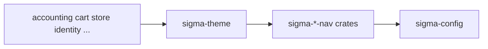

# sigma-theme architecture

`sigma-theme` is the shared site chrome library for Sigma Tactical Group web services. It supplies embedded static assets, Askama templates, copyright and security helpers, and optional Axum and Warp route builders consumed by every public-facing service.

## Context

This library owns no database and no runtime process of its own.

## Runtime shape

`sigma-theme` is a Rust library crate linked into service binaries as a git dependency. Feature flags gate optional stacks: `askama`, `site-nav`, `axum`, `warp`, `cache`, `content`, and `embed`. The crate uses `links = "sigma-theme"` and `build.rs` to publish compile-time paths (`DEP_SIGMA_THEME_TEMPLATES`, `DEP_SIGMA_THEME_ASSETS`) so dependents resolve Askama templates correctly over git.

Warp-based services call `sigma_theme::warp::serve` or compose `site_routes` with their own filters. Identity uses the `axum` module instead.

## Request flow

Services mount theme routes for `/static/*`, `/favicon.ico`, themed error recovery, and health integration helpers. `site_routes` wraps service-specific handlers with shared static assets and `/up`. `security_headers` applies CSP and standard security headers using the caller-supplied identity origin.

Cross-site navbar data comes from `site_nav` when the `site-nav` feature is enabled.

## Code map

| Path | Responsibility |
| --- | --- |
| `Cargo.toml` | Feature flags and nav crate dependencies. |
| `build.rs` | Publishes template and asset paths to dependents. |
| `assets/static/` | CSS, JS, and fonts (embedded via `rust-embed`). |
| `assets/templates/` | Askama base layout, error pages, and widgets. |
| `assets/keycloak/` | Keycloak login theme assets. |
| `ts/` | Authoritative TypeScript; esbuild output is committed under `assets/`. |
| `src/copyright.rs` | Copyright year helpers. |
| `src/security.rs` | CSP builders and security header constants. |
| `src/templates.rs` | Shared error and index rendering. |
| `src/nav/` | Navbar, menu, and breadcrumb types. |
| `src/site_nav.rs` | Cross-service nav chrome (`site-nav` feature). |
| `src/assets.rs` | Static asset embedding (`embed` feature). |
| `src/cache/` | TTL cache helpers (`cache` feature). |
| `src/content.rs` | Markdown and GitHub content fetching (`content` feature). |
| `src/axum.rs` | Axum router helpers (`axum` feature). |
| `src/warp.rs` | Warp filters, `listen_addr_from_env()`, graceful shutdown. |

## Data

The crate holds no application data. Embedded assets and templates ship inside the compiled library; content helpers cache remote Markdown in process memory when the `content` feature is enabled.

## Configuration

| Environment variable | Purpose |
| --- | --- |
| `PORT` | Default listen port for `listen_addr_from_env()` (default `8080`). |
| `SIGMA_STORE_PUBLIC_URL` | Cross-site nav link to the storefront. |
| `SIGMA_ORDERS_PUBLIC_URL` | Cross-site nav link to orders. |
| `SIGMA_UPDATES_PUBLIC_URL` | Cross-site nav link to updates. |
| `SIGMA_SIGMATACTICAL_ORG_PUBLIC_URL` | Cross-site nav link to sigmatactical.org. |
| `SIGMA_IDENTITY_PUBLIC_URL` | Cross-site nav link to identity. |
| `SIGMA_SENTRY_PUBLIC_URL` | Cross-site nav link to sentry. |
| `SIGMA_CONTACT_PUBLIC_URL` | Cross-site nav link to contact. |
| `SIGMA_SIGMATACTICALGROUP_COM_PUBLIC_URL` | Cross-site nav link to sigmatacticalgroup.com. |

Build-time variables `DEP_SIGMA_THEME_TEMPLATES` and `DEP_SIGMA_THEME_ASSETS` are set by this crate's `build.rs` for consuming build scripts.

## Deployment

There is no container image. Services compile `sigma-theme` in as a dependency; platform manifests configure each service's `PORT` and peer URLs independently.

## Testing

Run `cargo test --features askama,axum,warp` in the theme workspace. CI builds TypeScript first, runs tests with `--test-threads=1`, and fails if committed `assets/` differs from a fresh `ts/` rebuild. No PostgreSQL or external services are required.

## Design notes

- Brand artwork is proprietary; source is MIT/Apache-2.0 (`BRANDING.md`).
- Committed JS bundles let git consumers build without npm; CI enforces freshness.
- `CSP_ALTCHA` documents worker-src requirements for human-check widgets.
- Cross-site navbar URLs load once per process via `OnceLock`, with localhost fallbacks in development.
